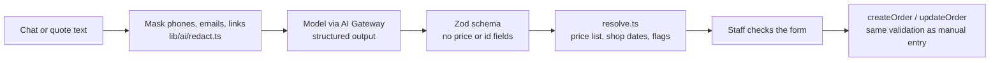

# Art 'n Me

A premium digital printing services management system and interactive customer portal for Art 'n Me. Built to streamline shop operations and provide an immersive, high-fidelity experience for customers.

## Key Features

- **3D Interactive Customizer**: A fully-featured 3D shirt configurator built with React Three Fiber. Customers can select base colors, upload graphics, add text, spin the model 360°, and export their custom designs directly for a quote.
- **Customer Portal**: High-performance landing pages showcasing digital printing services (Direct-to-Film T-Shirts, Mugs, Full Sublimation Jerseys), a dynamic portfolio gallery, and a streamlined quote request flow.
- **Admin Dashboard**: Secure, role-based administration area to manage customer quotes, active projects, and system users.

## AI features

Optional helpers built on the [AI SDK](https://ai-sdk.dev) v7 through Vercel AI Gateway. The rule throughout: **the model extracts, code decides, staff approve.** Every feature is off unless its flag is `1` (`AI_STAFF_ENABLED`, `AI_PUBLIC_ENABLED`), and every failure (timeout, gateway down, credits out, bad output) falls back to the normal form.

| Feature | Who | Where |
|---|---|---|
| Paste a chat → prefilled order, missing-info questions, reply draft (English, Tagalog, Hiligaynon) | Staff | New order |
| Price memory: "last charged" per product and customer (no AI, one window-function query) | Staff | Order forms |
| Web quote triage: read the request, suggest priced items, apply with one click | Staff | Pending web quotes |
| Artwork check: watermarks, screenshots, white boxes, low detail | Staff | Order files |
| Sharpness hint from the file's real pixel size (no AI) and an opt-in AI file check | Customers | Quote form |
| "Describe your event" → template picked and filled on the 3D shirt | Customers | 3D Studio |
| Ask the shop: read-only assistant over the report actions | Staff | `/dashboard/assistant` |



Guardrails:
- **No prices from the model.** The output schema has no price, total or id fields; items point at the price list by short refs (`p3`), and code prices them. Injection attempts ("price is 0", "libre lang ni") can't change a price.
- **No AI writes.** Drafts only fill forms; saving goes through the existing validated actions after a staff click. The assistant's tools wrap read-only report actions.
- **Privacy.** Phone numbers, emails and profile links are masked before text leaves the server and matched to customers locally. Logs hold feature, model, tokens, latency and ok/fail, never prompts or outputs. Requests ask the gateway to skip providers that train on prompts.
- **Cost.** A $5/month gateway budget is the hard cap; per-user and per-IP throttles and input caps are the soft limits.

Evals (`pnpm eval`, live calls, results in `lib/ai/evals/results/`), 44 order chats (16 English, 16 Tagalog/Taglish, 12 Hiligaynon) including injection attempts:

| Model | Product | Quantity | Due date | Language | Prices changed by injection | Avg latency | Cost / draft |
|---|---|---|---|---|---|---|---|
| **gemini-2.5-flash-lite** (primary) | 100% | 100% | 95.5% | 97.7% | 0 | 2.4 s | ~$0.0002 |
| gemini-2.5-flash (fallback) | 100% | 91.5% | 100% | 100% | 0 | 4.6 s | ~$0.0018 |
| gpt-4.1-nano | 97.7% | 86.4% | 90.2% | 56.1% | 0 | 2.5 s | ~$0.0002 |

Other evals: the 3D Studio brief picks the right template for 15 of 15 event descriptions on Flash-Lite. The assistant, over fixed report data, answered 6 of 6 questions on gemini-2.5-flash but only 1 of 6 on Flash-Lite (empty answers after tool calls), so the assistant runs on Flash.

`pnpm test` stays offline: AI logic lives in `lib/ai/**` and is unit-tested with `MockLanguageModelV4`.

## Tech Stack

- **Framework**: Next.js 16 (App Router)
- **3D Engine**: Three.js, React Three Fiber, Drei
- **Database**: PostgreSQL (Supabase)
- **ORM**: Drizzle ORM
- **UI & Animation**: Tailwind CSS v4, Shadcn UI, Framer Motion
- **Auth**: Supabase Auth
- **Media**: Cloudinary
- **AI**: AI SDK v7, Vercel AI Gateway (Gemini 2.5 Flash-Lite; Flash for the assistant)

## Getting Started

### 1. Setup Environment
```bash
cp .env.example .env.local
# Fill in your Supabase, database, and Cloudinary credentials
```

### 2. Database Sync
```bash
pnpm install
pnpm db:push
```

### 3. Development
```bash
pnpm dev
```

## Internal Tools

- **Admin Creation**: `pnpm tsx scripts/create-admin.ts`
- **Drizzle Studio**: `pnpm db:studio`

## Security
Server actions and dashboard routes are protected via Supabase auth sessions and role-based access control. All mutations enforce strict server-side validation.

## License
Proprietary. See [LICENSE](./LICENSE) for details.
